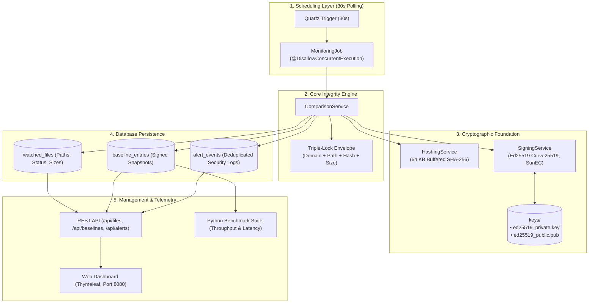
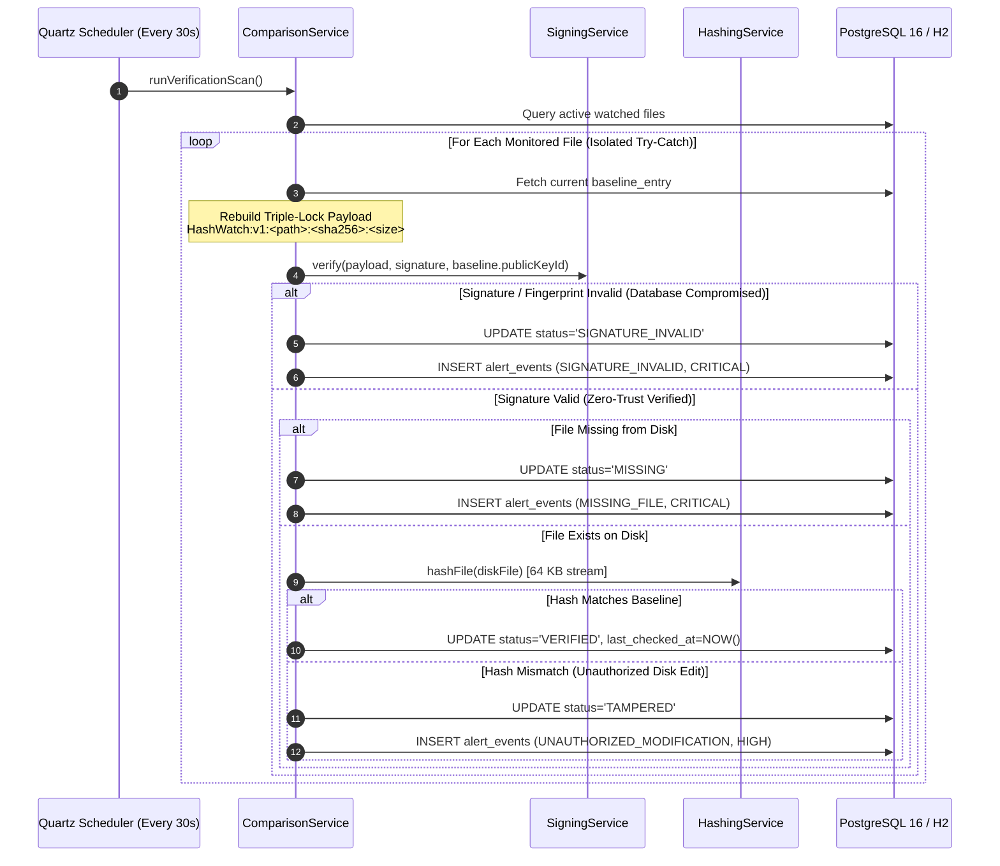

# HashWatch 🛡️

<div align="center">

[](https://openjdk.org/)
[](https://spring.io/projects/spring-boot)
[](https://www.postgresql.org/)
[](https://ed25519.cr.yp.to/)
[](https://github.com/PG300604/HashWatch/actions)
[](https://github.com/PG300604/HashWatch)
[](Dockerfile)
[](LICENSE)

<br/>

**A Cryptographically Signed, Zero-Trust File Integrity & Baseline Monitoring System**  
*Department of Computer Science and Business Systems (CSBS), Asansol Engineering College*  
Upstream Repository: [https://github.com/PG300604/HashWatch.git](https://github.com/PG300604/HashWatch.git)

<br/>

[Executive Summary](#-executive-summary--vision) &bull;
[Core Innovations](#-core-innovations--architectural-highlights) &bull;
[Market Comparison Matrix](#-market-comparison-matrix) &bull;
[System Architecture](#-system-architecture--workflow) &bull;
[Zero-Trust Sequence](#-zero-trust-verification-sequence) &bull;
[Automated Test Suite (98 Tests)](#-automated-testing--verification-98-tests-passing) &bull;
[Sprint Milestones](#-agile-sprint-breakdown--progress-matrix) &bull;
[Team & Domain Matrix](#-academic-project-team--domain-specialization-matrix) &bull;
[Quickstart](#-quick-start-running-locally-in-60-seconds) &bull;
[Documentation Sitemap](#-deep-dives--documentation-sitemap)

</div>

---

## 🎯 Executive Summary & Vision

In enterprise IT, critical infrastructure, and cloud environments, unauthorized modifications to sensitive configuration and executable files (`/etc/pam.d/`, `/etc/sudoers`, Windows drivers, database definitions, payment gateways) represent the primary vector for stealth backdoors, privilege escalation, and advanced persistent threats (APTs).

Traditional File Integrity Monitoring (FIM) tools (such as legacy Tripwire, OSSEC, or AIDE) calculate checksums and store them in flat configuration files or standard relational database tables. If an adversary acquires root or database access, they execute a **Baseline Poisoning Attack**—modifying the disk file and silently rewriting the expected hash in storage, leaving the monitoring system entirely blind.

**HashWatch eliminates this vulnerability** through **Zero-Trust Asymmetric Baselines**:
1. Every monitored file baseline is sealed with a digital signature using the **Edwards-curve Digital Signature Algorithm (Ed25519)** using native Java 17/21 JCA (`SunEC`).
2. During continuous automated verification loops, the comparison engine **cryptographically validates the baseline's digital signature and key fingerprint before trusting the stored hash**.
3. If an attacker tampers with the disk file, HashWatch alerts with **`TAMPERED`**. If an attacker tampers with the database record, HashWatch rejects the signature and raises a high-priority **`SIGNATURE_INVALID`** security alert.

---

## 💡 Core Innovations & Architectural Highlights

```
┌──────────────────────────────────────────────────────────────────────────────────┐
│                             HASHWATCH 5 CORE PILLARS                             │
├──────────────────────────────────────────────────────────────────────────────────┤
│ 1. 🔏 Zero-Trust Baselines     : Signature authenticity verified before match    │
│ 2. 🛡️ Triple-Lock Envelope     : Domain + Path + Hash + Size cryptographic lock  │
│ 3. 🔑 Fingerprint Pinning      : SHA-256 fingerprint prevents key substitution   │
│ 4. ⚙️ 5-State Integrity Engine : Distinguishes file vs database compromise       │
│ 5. 🪶 In-Place & Zero Bloat    : Files remain in-place; < 64 KB memory footprint │
└──────────────────────────────────────────────────────────────────────────────────┘
```

### 1. The Triple-Lock Canonical Envelope
To neutralize database row-swapping attacks (copying a valid signature from an innocuous file to a compromised row), HashWatch binds the signature to a strict domain-separated canonical payload:
$$\text{Canonical Payload} = \text{HashWatch:v1:} + \text{NormalizedPath} + \text{":"} + \text{SHA256} + \text{":"} + \text{FileSizeBytes}$$
* **Domain Tag (`HashWatch:v1`):** Enforces strict protocol boundary separation (RFC 8032).
* **Normalized Absolute Path:** Cryptographically tethers the signature to the exact file path.
* **Streaming SHA-256 Digest:** Verifies disk payload integrity using 64 KB chunked streaming.
* **Exact Byte Size:** Provides a secondary physical invariant against preimage collision attacks.

### 2. Fingerprint-Pinned Key Verification
Every baseline snapshot stores the SHA-256 fingerprint (`publicKeyId`) of the authorized keypair. During verification sweeps, HashWatch confirms that the active public key matches the pinned fingerprint before verifying the curve equation, preventing rogue key injection attacks.

### 3. The 5-State Deterministic Integrity Machine
Unlike simplistic binary "Pass/Fail" monitors, HashWatch implements a deterministic 5-state integrity machine:
* **`VERIFIED`:** Baseline signature is authentic and live disk file matches the expected hash.
* **`TAMPERED`:** Baseline signature is authentic, but disk contents have been modified.
* **`MISSING`:** Registered file has been removed or unlinked from disk storage.
* **`SIGNATURE_INVALID`:** Cryptographic signature verification failed—alerts operators that **the database record or signature was poisoned**.
* **`UNTRACKED`:** Newly registered file pending initial cryptographic baseline generation.

### 4. Alert Fatigue Mitigation (State-Transition Gating)
In a 30-second polling cycle, an unthrottled monitor checking a modified file generates **2,880 alerts/day**. HashWatch implements state-transition gating: new `AlertEvent` entries are generated only upon active state transitions or when no unresolved alert is open, preventing operator fatigue and database bloating.

### 5. In-Place Monitoring (Zero File Bloat)
HashWatch is an **in-place integrity monitor, not a cloud drive or file vault**. Files remain untouched in their native filesystem paths. Memory consumption is capped at $<64$ KB per stream regardless of whether the target file is 10 KB or 50 GB.

---

## 📊 Market Comparison Matrix

| Architectural Capability | HashWatch | Legacy Tripwire | AIDE | OSSEC / Wazuh | Samhain |
| :--- | :---: | :---: | :---: | :---: | :---: |
| **Asymmetric Digital Signatures** | **Native (Ed25519)** | None (Plain DB) | None (Plain DB) | None (Plain text) | GPG (External subprocess) |
| **Zero-Trust Baseline Verification** | **Native JCA (SunEC)** | ❌ No | ❌ No | ❌ No | Partial |
| **Database Tamper Detection (`SIGNATURE_INVALID`)** | **Automated** | ❌ Blind | ❌ Blind | ❌ Blind | ❌ Blind |
| **Triple-Lock Canonical Envelope** | **Domain + Path + Hash + Size** | Hash only | Hash only | Hash only | Hash only |
| **Public Key Fingerprint Pinning** | **SHA-256 Hex Fingerprint** | ❌ No | ❌ No | ❌ No | ❌ No |
| **In-Place File Processing** | **< 64 KB RAM Stream** | Varies | Local scan | Agent daemon | Local scan |
| **Interactive SOC Web Cockpit** | **Obsidian & Electric Vermilion** | Commercial Web UI | None (CLI only) | Kibana Dashboard | None (CGI/Web) |
| **Live Rest API Triage & Manual Scans** | **Spring Boot REST Endpoints** | Proprietary | None | REST API | None |
| **Automated Non-Blocking Quartz Daemon** | **Native Memory JobStore** | Cron job | Cron job | Polling thread | Periodic daemon |
| **Micro-Benchmark Validation** | **snaproot & Bernstein Paper Compliant** | Generic | Generic | Generic | Generic |

---

## 🏗️ System Architecture & Workflow



---

## 🔄 Zero-Trust Verification Sequence



---

## 🧪 Automated Testing & Verification (98 Tests Passing)

HashWatch enforces rigorous automated test coverage across cryptographic algorithms, database queries, MockMvc controllers, Quartz execution loops, and end-to-end tamper detection:

```powershell
# Windows
.\mvnw.cmd test

# Linux / macOS
./mvnw test
```

### Complete Test Suite Breakdown (98 / 98 Tests Passing):

| Test Class | Layer / Domain | Tests | Verification Focus & Edge Cases Tested | Status |
| :--- | :--- | :---: | :--- | :---: |
| [`TamperDetectionIntegrationTest`](src/test/java/com/hashwatch/integration/TamperDetectionIntegrationTest.java) | **End-to-End Cryptography** | **10** | Byte-level tampering, single-bit flip sensitivity (100% avalanche), DB baseline & size tampering, key rotation continuity, missing/restored recovery, mixed-state batch scan, deduplication | ✅ 100% Passing |
| [`AlertEventRepositoryTest`](src/test/java/com/hashwatch/repository/AlertEventRepositoryTest.java) | **DBMS & Persistence** | **18** | Unresolved queries, severity filters, event-type lookups, date-range bounds, per-file paths, paginated result sets, aggregation count queries | ✅ 100% Passing |
| [`SigningServiceTest`](src/test/java/com/hashwatch/service/SigningServiceTest.java) | **Cryptology & Key Lifecycle** | **13** | Edwards-curve signature generation/verification, Base64/X.509 disk persistence, key rotation with timestamped archives, RFC 7468 PEM/DER export, detached signatures | ✅ 100% Passing |
| [`ComparisonServiceTest`](src/test/java/com/hashwatch/service/ComparisonServiceTest.java) | **Backend Verification** | **13** | Triple-Lock envelope & slash normalization, fingerprint pinning, 5-state integrity transitions, directory-replacement & untracked guards, alert deduplication, batch fault isolation | ✅ 100% Passing |
| [`FileControllerTest`](src/test/java/com/hashwatch/controller/FileControllerTest.java) | **REST API & Safety** | **12** | Single/batch registration, atomic baselining, path canonicalization, 100 MB sync cap, soft-delete reactivation, duplicate conflict (409) handling | ✅ 100% Passing |
| [`RepositoryIntegrationTest`](src/test/java/com/hashwatch/repository/RepositoryIntegrationTest.java) | **DBMS Schema & Enums** | **8** | Strongly-typed enums (`FileStatus`, `EventType`, `AlertSeverity`), JPA `@Index`, cascade/set-null FK rules, unique path constraints | ✅ 100% Passing |
| [`DashboardViewControllerTest`](src/test/java/com/hashwatch/controller/DashboardViewControllerTest.java) | **Frontend & Model Binding** | **5** | High-density KPI binding, `/` and `/dashboard` dual route alias, CodeRabbit alert cap triage, direct `countByStatus` SQL optimizations | ✅ 100% Passing |
| [`AlertControllerTest`](src/test/java/com/hashwatch/controller/AlertControllerTest.java) | **REST API & Triage** | **5** | Unresolved incident feed, recent 50 audit trail, 1-click `/resolve` actions, on-demand manual `/scan-now` triggers | ✅ 100% Passing |
| [`BaselineControllerTest`](src/test/java/com/hashwatch/controller/BaselineControllerTest.java) | **REST API & Baselines** | **5** | Active baseline feeds, Ed25519 public key & fingerprint export, single-file re-baselining, batch re-baseline execution | ✅ 100% Passing |
| [`HashingServiceTest`](src/test/java/com/hashwatch/service/HashingServiceTest.java) | **Cryptology Primitives** | **5** | 64 KB chunked SHA-256 streaming, memory safety limits, empty string/file validation, null rejection | ✅ 100% Passing |
| [`MonitoringJobTest`](src/test/java/com/hashwatch/scheduler/MonitoringJobTest.java) | **Scheduler & Resilience** | **3** | Quartz execution loop, `@DisallowConcurrentExecution` concurrency locks, exception boundaries preventing rapid refire storms | ✅ 100% Passing |
| [`HashWatchApplicationTests`](src/test/java/com/hashwatch/HashWatchApplicationTests.java) | **Spring Boot Context** | **1** | Full Spring Boot container bootstrap and context initialization | ✅ 100% Passing |
| **Total Test Suite** | **All 12 System Layers** | **98** | **Full Regression & Integration Suite Validated Under GitHub Actions CI** | **✅ 100% GREEN** |

---

## 📈 Agile Sprint Breakdown & Progress Matrix

| Sprint | Milestones & Core Objectives | Pull Requests | Delivered Components & Outcomes | Status |
| :---: | :--- | :---: | :--- | :---: |
| **Sprint 1** | Project base, Maven Wrapper, PostgreSQL schema, Cryptographic primitives | [PR #3](https://github.com/PG300604/HashWatch/pull/3), [PR #4](https://github.com/PG300604/HashWatch/pull/4), [PR #5](https://github.com/PG300604/HashWatch/pull/5), [PR #6](https://github.com/PG300604/HashWatch/pull/6) | Maven Wrapper (3.9.9), JPA enums, HikariCP pool, Ed25519 signing engine, 64 KB SHA-256 streaming, 8 JPA tests. | ✅ **100% Merged** |
| **Sprint 2** | Core comparison engine, Quartz scheduler, and alert persistence query layer | [PR #7](https://github.com/PG300604/HashWatch/pull/7), [PR #8](https://github.com/PG300604/HashWatch/pull/8), [PR #10](https://github.com/PG300604/HashWatch/pull/10) | Triple-Lock canonical envelope, fingerprint pinning, 5-state integrity machine, Quartz 30s scheduler loop, 18 alert query methods. | ✅ **100% Merged** |
| **Sprint 3** | REST API contracts, baseline management endpoints, and key rotation | [PR #9](https://github.com/PG300604/HashWatch/pull/9), [PR #11](https://github.com/PG300604/HashWatch/pull/11), [PR #15](https://github.com/PG300604/HashWatch/pull/15) | FileController, BaselineController, AlertController, Ed25519 key rotation with timestamped archives, RFC 7468 PEM/DER export. | ✅ **100% Merged** |
| **Sprint 4** | Interactive web dashboard, SOC design system, and MVC model binding | [PR #16](https://github.com/PG300604/HashWatch/pull/16), [PR #17](https://github.com/PG300604/HashWatch/pull/17), [PR #18](https://github.com/PG300604/HashWatch/pull/18) | Obsidian & Electric Vermilion SOC cockpit, `dashboard.html`, `alerts.html`, `app.js` SVG toasts, `DashboardViewController` count queries. | ✅ **100% Merged** |
| **Sprint 5** | Containerization, CI/CD pipeline, cryptographic & latency benchmarks, tamper testing | [PR #13](https://github.com/PG300604/HashWatch/pull/13), [PR #19](https://github.com/PG300604/HashWatch/pull/19), [PR #20](https://github.com/PG300604/HashWatch/pull/20) | Multi-stage Dockerfile, GitHub Actions CI, SHA-256 (1.87–2.01 GB/s), Ed25519 (30.5k sign/13.8k verify/s), stochastic latency (14.83s mean, 28.42s P95), tamper suite. | ✅ **100% Merged** |
| **Sprint 6** | System hardening, corner-case tests, academic report, user manual, defense deck | [PR #14](https://github.com/PG300604/HashWatch/pull/14), [PR #21](https://github.com/PG300604/HashWatch/pull/21), [PR #22](https://github.com/PG300604/HashWatch/pull/22) | Final Academic Report, Operator User Manual, Defense Presentation Deck, S6-T3 corner-case hardening (98/98 tests), documentation reconciliation. | ✅ **100% Merged** |

---

## 👥 Academic Project Team & Domain Specialization Matrix

**HashWatch** is designed and implemented by **Group 3**, Department of Computer Science and Business Systems (**CSBS**), **Asansol Engineering College**:

| Team Member | GitHub Profile | Declared Competency Domains | Shipped Deliverables & Pull Requests | Authorship / Co-Authorship Highlights |
| :--- | :--- | :--- | :--- | :--- |
| **Priyanshu Ghosh**<br/>*(Project Lead)* | [`@PG300604`](https://github.com/PG300604) | **DevOps**, **DBMS**, **Backend**, **Analysis**, **Cryptology** | **PR #3, #4, #8, #9, #16, #17, #19, #21, #22**<br/>• Multi-stage Docker containerization & GitHub Actions CI (`.github/workflows/ci.yml`)<br/>• Comparison engine with Triple-Lock envelope (`ComparisonService.java`)<br/>• REST API controllers (`FileController.java`, `BaselineController.java`, `AlertController.java`)<br/>• Obsidian & Electric Vermilion SOC design system (`style.css`, `dashboard.html`)<br/>• Cryptographic micro-benchmarking suite (`python-analysis/overhead_benchmark.py`) & S6-T3 corner-case hardening | Lead author of DevOps, DBMS schema, Comparison engine, and Sprint 6 hardening.<br/>Co-author on [DashboardViewController](src/main/java/com/hashwatch/controller/DashboardViewController.java) (S4-T3), [TamperDetectionIntegrationTest](src/test/java/com/hashwatch/integration/TamperDetectionIntegrationTest.java) (S5-T4), and Sprint 6 reconciliation. |
| **Riya** | [`@riyaaa0710`](https://github.com/riyaaa0710) | **Cryptology**, **REST API Contracts**, **Frontend UI**, **DBMS** | **PR #6, #10, #11, #13, #14**<br/>• Native Java 17/21 LTS Ed25519 signing engine & key persistence (`SigningService.java`)<br/>• 18 Spring Data JPA derived query methods in `AlertEventRepository.java`<br/>• REST API contract schemas (`docs/TRD.md` Sec 5)<br/>• Thymeleaf dashboard templates and alert triage view (`alerts.html`)<br/>• End-to-end tamper integration suite (S5-T4) & Academic deliverables (`FINAL_ACADEMIC_REPORT.md`, `USER_MANUAL.md`, `PROJECT_DEFENSE_PRESENTATION.md`) | Lead author of Ed25519 signing primitives, AlertEvent queries, Tamper integration test suite, and Academic documentation.<br/>Co-authored UI templates and REST controllers with Priyanshu. |
| **Samarjeet Kumar** | [`@samarjeet-kr`](https://github.com/samarjeet-kr) | **Backend**, **Cryptology**, **DBMS Queries**, **Analysis** | **PR #5, #7, #15, #18, #20**<br/>• 64 KB chunked SHA-256 streaming hashing (`HashingService.java`)<br/>• Resilient Quartz scheduled execution loop (`MonitoringJob.java`, `SchedulerConfig.java`)<br/>• Ed25519 automated key rotation with timestamped archives & RFC 7468 PEM/DER export (`SigningService.java`)<br/>• MVC model attribute binding and SQL count queries in `DashboardViewController.java` (S4-T3 / SB-1)<br/>• Stochastic detection latency analysis (`latency_analysis.py`, P50/P95/P99) & Maven mirror CI resilience (S5-T3) | Lead author of SHA-256 streaming, Quartz job resilience, key rotation mechanisms, Dashboard view controller, and latency distribution analysis.<br/>Co-authored on view controller with Priyanshu. |

---

## 🚀 Quick Start (Running Locally in 60 Seconds)

### Prerequisites
* **Java 17 LTS or Java 21 LTS** (Eclipse Temurin / OpenJDK recommended)
* **Git** installed on host machine
* *(Optional)* **Docker & Docker Compose** for production PostgreSQL deployment

### 1. Clone Repository
```bash
git clone https://github.com/PG300604/HashWatch.git
cd HashWatch
```

### 2. Run with In-Memory H2 Database (Default — Zero Setup)
The project includes bundled Apache Maven Wrapper scripts (`mvnw` / `mvnw.cmd`):
```powershell
# Windows PowerShell
.\mvnw.cmd spring-boot:run

# Linux / macOS
./mvnw spring-boot:run
```

### 3. (Optional) Run with Production PostgreSQL 16 via Docker
```bash
# Launch PostgreSQL 16 container with healthcheck gating
docker compose up -d

# Run application using the 'postgres' Spring profile
.\mvnw.cmd spring-boot:run -Dspring-boot.run.profiles=postgres
```

### 4. Access Web Dashboard
Open your web browser and navigate to:  
👉 **[http://localhost:8080](http://localhost:8080)** (or **[http://localhost:8080/alerts](http://localhost:8080/alerts)** for security incidents triage).

---

## 📖 Deep Dives & Documentation Sitemap

| Specification Document | Content Summary |
| :--- | :--- |
| **[`docs/BRAIN.md`](docs/BRAIN.md)** | **Architecture Decision Records (ADRs):** Comprehensive log of all cryptographic, storage, and scheduling architectural choices. |
| **[`docs/PRD.md`](docs/PRD.md)** | **Product Requirements Document:** Problem statement, target personas, compliance mappings (PCI-DSS 11.5, SOC 2), and functional specs. |
| **[`docs/TRD.md`](docs/TRD.md)** | **Technical Requirements Document:** Mathematical specifications for Ed25519, SHA-256 streaming buffers, and complete OpenAPI/REST contracts. |
| **[`docs/ERD.md`](docs/ERD.md)** | **Entity-Relationship Document:** Complete relational schema, PostgreSQL DDL script, indexing strategies, referential integrity. |
| **[`docs/DFD.md`](docs/DFD.md)** | **Data Flow Diagrams:** Level 0 Context diagram, Level 1 decomposition, Level 2 sub-process sequence flows. |
| **[`docs/ROLES.md`](docs/ROLES.md)** | **Agile Team Collaboration Model:** Domain competency matrix, fork-and-pull workflow, conventional commits, and review protocol. |
| **[`docs/SPRINT_PLAN.md`](docs/SPRINT_PLAN.md)** | **Sprint Task Allocation:** Detailed breakdown of task tickets (S1-T1 through S6-T3), assigned domains, folder boundaries, and Definition of Done. |
| **[`docs/TIMELINE.md`](docs/TIMELINE.md)** | **Academic Milestones:** Visual Mermaid Gantt timeline tracking sprint cutoffs and project delivery schedule. |
| **[`docs/WEEKLY_DEADLINES.md`](docs/WEEKLY_DEADLINES.md)** | **Deliverables Checklist:** Acceptance criteria and submission verification checklist for weekly academic reviews. |
| **[`docs/PACKAGE_STRUCTURE.md`](docs/PACKAGE_STRUCTURE.md)** | **Source Code Index:** Structural folder mapping covering all Java packages, tests, resources, and python benchmark scripts. |
| **[`docs/RESEARCH_BENCHMARKS.md`](docs/RESEARCH_BENCHMARKS.md)** | **Empirical Academic Comparison:** Benchmark comparison against *snaproot* (arXiv:2606.10625) and Bernstein's reference Ed25519 paper. |
| **[`docs/SETUP.md`](docs/SETUP.md)** | **Developer Onboarding:** Local development setup, Docker deployment, and troubleshooting guide. |

---

## 📜 License

This project is licensed under the **MIT License** — see the [`LICENSE`](LICENSE) file for details.
