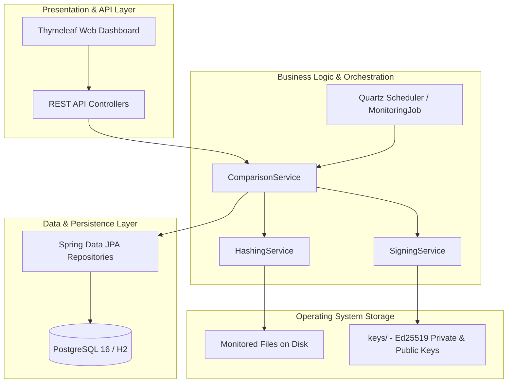

# Technical Requirements Document (TRD) — HashWatch

---

## 1. System Architecture Overview

HashWatch adopts a modular layered architecture built on the Spring Boot 3 ecosystem running on Java 17 LTS. The system is partitioned into:
1. **Core Cryptographic Engine:** Hashing (`SHA-256`) and Digital Signatures (`Ed25519`).
2. **Persistence & Data Layer:** Spring Data JPA with Hibernate, targeting PostgreSQL 16 (with H2 in-memory profile for lightweight local runs).
3. **Orchestration / Scheduling Layer:** Quartz Job Scheduler for reliable, configurable periodic execution.
4. **Presentation & API Layer:** Spring MVC REST controllers accompanied by server-rendered Thymeleaf HTML5 views.
5. **Offline Analysis & Benchmarking Layer:** Python 3 analysis suite consuming database telemetry to benchmark throughput and latency.



---

## 2. Technology Stack & Rationale

| Layer | Technology | Version | Rationale |
| :--- | :--- | :--- | :--- |
| **Language** | Java | 17 (LTS) | Strong typing, LTS stability, native JCA Ed25519 support (JEP 339), modern heap memory management. |
| **Build Tool** | Apache Maven Wrapper | 3.9.9 (`mvnw`) | Zero-binary (`only-script`) wrapper ensures identical build environment across Windows, Linux, and CI. |
| **Framework** | Spring Boot | 3.3.4 | Industry-standard dependency injection, autoconfiguration, embedded Tomcat, native metrics. |
| **Database** | PostgreSQL | 16-alpine | Enterprise ACID compliance, robust indexing on hashes and timestamps, production standard. |
| **Fallback DB** | H2 Database | 2.x | Zero-setup in-memory database for rapid onboarding and `@DataJpaTest` unit testing. |
| **Connection Pool** | HikariCP | 5.x | High-performance JDBC connection pooling (`HashWatchHikariPool`: max 10, min idle 2). |
| **Scheduler** | Quartz Scheduler | 2.3.x | Enterprise job clustering support, durable job details, flexible cron and simple trigger intervals. |
| **Cryptography** | Java JCA + BouncyCastle | 1.78.1 | RFC 8032 Ed25519 compliant, PKCS#8 and X.509 standard key encodings. |
| **Frontend** | Thymeleaf + CSS/JS | 3.x | Zero-node build step, server-side rendered, lightweight, high performance. |
| **Analysis** | Python + Matplotlib + NumPy | 3.12+ | Rich statistical packages for CDF/PDF latency plotting and research comparison. |

### 2.1. Quartz Scheduler & Resilient Periodic Monitoring (Sprint 2: S2-T2)
The background monitoring heartbeat is orchestrated using Spring Boot Quartz:
- **`MonitoringJob` ([`MonitoringJob.java`](../src/main/java/com/hashwatch/scheduler/MonitoringJob.java)):**
  - Annotated with `@DisallowConcurrentExecution` to prevent overlapping scan runs when monitoring large directories or high-latency file systems.
  - Automatically times scan executions and logs duration.
  - Exception barrier catches I/O and runtime errors, re-wrapping them into `JobExecutionException` with `setRefireImmediately(false)` to prevent tight failure loops while preserving scheduler health.
- **`SchedulerConfig` ([`SchedulerConfig.java`](../src/main/java/com/hashwatch/config/SchedulerConfig.java)):**
  - Driven by properties `hashwatch.monitor.scan-interval-seconds` (default: 30s) and `hashwatch.monitor.scan-enabled` (default: true).
  - Configures durable job detail (`fileMonitoringJob`, group `integrityGroup`) and trigger (`fileMonitoringTrigger`).
  - Misfire policy configured with `withMisfireHandlingInstructionNextWithExistingCount()` ensuring timely recovery without bursting accumulated missed executions.
- **Unit Testing:** [`MonitoringJobTest.java`](../src/test/java/com/hashwatch/scheduler/MonitoringJobTest.java) verifies invocation delegation, error containment without immediate refires, and configuration beans (3/3 unit tests passing).

---

## 3. Cryptographic Implementation Details

### 3.1. SHA-256 Streaming
Rather than loading an entire file into memory (which causes `OutOfMemoryError` on large files), HashWatch processes files in chunks:
```java
MessageDigest digest = MessageDigest.getInstance("SHA-256");
try (FileInputStream fis = new FileInputStream(file)) {
    byte[] buffer = new byte[65536]; // 64 KB buffer
    int bytesRead;
    while ((bytesRead = fis.read(buffer)) != -1) {
        digest.update(buffer, 0, bytesRead);
    }
}
String hexDigest = HexFormat.of().formatHex(digest.digest());
```
- **Time Complexity:** $\mathcal{O}(N)$ where $N$ is file size.
- **Space Complexity:** $\mathcal{O}(1)$ bounded to 64 KB heap allocation.
- **Implementation:** [`HashingService.java`](../src/main/java/com/hashwatch/service/HashingService.java) implements `hashFile(File)` and `hashString(String)` with explicit null/existence checks and lowercase 64-char hex outputs.
- **Test Verification:** [`HashingServiceTest.java`](../src/test/java/com/hashwatch/service/HashingServiceTest.java) validates empty string RFC vector (`e3b0c44...`), file modification sensitivity, and input boundary exception handling (5/5 unit tests passing).

### 3.2. Ed25519 Digital Signatures (Edwards-curve Digital Signature Algorithm) — (Sprint 1: S1-T2)
- **Implementation:** [`SigningService.java`](../src/main/java/com/hashwatch/service/SigningService.java) utilizing Java 17 LTS native JCA (`SunEC` / JEP 339).
- **Curve:** Curve25519 with Twisted Edwards model ($ -x^2 + y^2 = 1 - \frac{121665}{121666} x^2 y^2 $).
- **Key Formats & Persistence:**
  - **Private Key:** Stored at `keys/ed25519_private.key` as Base64-encoded PKCS#8 (`PKCS8EncodedKeySpec`).
  - **Public Key:** Stored at `keys/ed25519_public.pub` as Base64-encoded X.509 (`X509EncodedKeySpec`).
  - **Auto-Initialization:** `@PostConstruct` automatically resolves the key directory (configurable via `hashwatch.crypto.key-directory`), creates it if absent, loads existing keys, or generates a fresh 256-bit keypair on initial boot.
- **Signature Specification:**
  - **Signature Algorithm:** Standard Ed25519 (RFC 8032) producing raw 64-byte cryptographic signatures encoded in Base64 string format (~86-88 characters).
  - **Signing:** Computes signature over UTF-8 bytes of SHA-256 digest strings using `Signature.getInstance("Ed25519")`.
  - **Verification & Tamper Resilience:** Validates signature against provided string data. Gracefully catches null/blank inputs, malformed Base64, and corrupted byte arrays, returning `false` (`SIGNATURE_INVALID`) rather than throwing unhandled runtime exceptions.
- **Security Guarantee:** 128-bit security level against collision and discrete logarithm attacks; immune to timing side-channel attacks. The private key is excluded in `.gitignore` and never exposed over the REST API.
- **Verification Suite:** Validated by 5 automated tests in [`SigningServiceTest.java`](../src/test/java/com/hashwatch/service/SigningServiceTest.java) covering genuine signing/verification, tampered digest rejection, cross-instance key persistence reload, and malformed signature handling.

---

## 4. Database Design, Connection Pooling & Persistence (Sprint 1: S1-T1 & S1-T4)

### 4.1. Dual-Profile & HikariCP Configuration
- **Default Profile (`h2`):** Activated in [`application.properties`](../src/main/resources/application.properties) (`spring.profiles.active=h2`) using [`application-h2.properties`](../src/main/resources/application-h2.properties) for instant zero-setup development and automated testing.
- **Production Profile (`postgres`):** Activated via `-Dspring-boot.run.profiles=postgres` using [`application-postgres.properties`](../src/main/resources/application-postgres.properties) targeting PostgreSQL 16 (`localhost:5432/hashwatch_db`).
- **HikariCP Settings (`HashWatchHikariPool`):**
  - `maximum-pool-size=10`, `minimum-idle=2`, `idle-timeout=300000` (5m), `connection-timeout=20000` (20s), `max-lifetime=1800000` (30m).
  - `spring.jpa.open-in-view=false` to enforce clean transaction boundaries before the view layer.

### 4.2. Strongly-Typed Domain Enums & Schema Migration Safety
All status and classification fields use Java `enum` types annotated with `@Enumerated(EnumType.STRING)` and `@ColumnDefault` so database migrations and native SQL inserts remain safe:
- [`FileStatus`](../src/main/java/com/hashwatch/entity/FileStatus.java): `VERIFIED`, `TAMPERED`, `MISSING`, `UNTRACKED` (default via `@ColumnDefault("'UNTRACKED'")` and `@PrePersist`), `SIGNATURE_INVALID`.
- [`EventType`](../src/main/java/com/hashwatch/entity/EventType.java): `MISMATCH`, `UNAUTHORIZED_MODIFICATION`, `MISSING_FILE`, `SIGNATURE_INVALID`.
- [`AlertSeverity`](../src/main/java/com/hashwatch/entity/AlertSeverity.java): `LOW`, `MEDIUM`, `HIGH`, `CRITICAL`.

### 4.3. Relational Tables & Referential Integrity
1. **`watched_files` ([`WatchedFile.java`](../src/main/java/com/hashwatch/entity/WatchedFile.java))**: Registry of monitored paths, status, size, and modification timestamps. Indexed by `idx_watched_files_path` (unique), `idx_watched_files_active`, and `idx_watched_files_status`.
2. **`baseline_entries` ([`BaselineEntry.java`](../src/main/java/com/hashwatch/entity/BaselineEntry.java))**: Immutable snapshots containing the 64-character SHA-256 hash, Ed25519 signature, and `is_current` flag. Foreign key `fk_baseline_watched_file` enforces **`ON DELETE CASCADE`** when a parent `WatchedFile` is deleted.
3. **`alert_events` ([`AlertEvent.java`](../src/main/java/com/hashwatch/entity/AlertEvent.java))**: Audit trail of integrity violations. Foreign key `fk_alert_watched_file` enforces **`ON DELETE SET NULL`** so historical security alerts and their `file_path` snapshots survive even if a monitored file record is later deleted.

### 4.4. Automated `@DataJpaTest` Verification ([`RepositoryIntegrationTest.java`](../src/test/java/com/hashwatch/repository/RepositoryIntegrationTest.java))
8 integration tests validate the persistence layer:
1. `testSaveAndQueryWatchedFile` — `@PrePersist` defaults and active/status queries.
2. `testAllEnumValuesMapToDatabaseStrings` — Persists and retrieves all 5 `FileStatus` values and all $4 \times 4 = 16$ `EventType` $\times$ `AlertSeverity` combinations, verifying exact `VARCHAR` representations in the database.
3. `testSchemaMigrationAndRowsMissingStatusDefaultToUntracked` — Verifies pre-existing rows missing `status` default to `FileStatus.UNTRACKED`.
4. `testUniqueFilePathConstraint` — Verifies `DataIntegrityViolationException` on duplicate `file_path`.
5. `testBaselineRotationAndLookup` — Verifies baseline creation, retirement (`is_current = false`), and historical ordering.
6. `testAlertEventPersistenceAndTriage` — Verifies alert logging, unresolved queries, and resolution updates.
7. `testDeleteWatchedFileCascadesToBaselineAndSetsNullOnAlertEvent` — Verifies `ON DELETE CASCADE` on `baseline_entries` and `ON DELETE SET NULL` on `alert_events`.
8. `testAlertEventCreationWithNullWatchedFileReference` — Verifies detached `AlertEvent` persistence with `watched_file_id = NULL`.

*(See [`docs/ERD.md`](ERD.md) for full SQL definitions and Mermaid entity schemas).*

---

## 5. REST API Specifications & OpenAPI Contract (Sprint 3: S3-T1, S3-T2, SA-5)

All REST API endpoints are exposed under base path `/api` with `Content-Type: application/json`. Error responses follow standard JSON error objects with `status`, `error`, and `message` fields.

### 5.1. File Management Endpoints (`FileController.java`)

#### 1. `GET /api/files` — List Monitored Files
- **Description:** Returns the inventory of monitored files.
- **Query Parameters:**
  - `activeOnly` (optional, boolean, default: `false`): When `true`, filters only files with `is_active = true`.
- **Response `200 OK`:**
  ```json
  [
    {
      "id": 1,
      "filePath": "/etc/nginx/nginx.conf",
      "fileSize": 2048,
      "lastModified": "2026-10-24T14:30:00",
      "status": "VERIFIED",
      "active": true,
      "createdAt": "2026-10-24T10:15:00"
    }
  ]
  ```

#### 2. `GET /api/files/{id}` — Retrieve Single Monitored File
- **Description:** Retrieves metadata for a specific watched file by primary key.
- **Path Parameter:** `id` (Long, required).
- **Response `200 OK`:** Single `WatchedFile` JSON object.
- **Response `404 Not Found`:** File ID does not exist.

#### 3. `POST /api/files` — Register File & Establish Initial Baseline
- **Description:** Registers a new file for integrity monitoring, calculates its streaming SHA-256 hash, builds the Triple-Lock canonical envelope, and generates an Ed25519 digital signature.
- **Request Headers:** `Content-Type: application/json`
- **Request Body:**
  ```json
  {
    "filePath": "/var/log/secure.log"
  }
  ```
- **Response `201 Created`:**
  ```json
  {
    "message": "File successfully registered and initial cryptographic baseline established",
    "file": {
      "id": 2,
      "filePath": "/var/log/secure.log",
      "fileSize": 4096,
      "lastModified": "2026-10-24T16:00:00",
      "status": "VERIFIED",
      "active": true,
      "createdAt": "2026-10-24T16:05:00"
    },
    "baseline": {
      "id": 1,
      "sha256Hash": "e3b0c44298fc1c149afbf4c8996fb92427ae41e4649b934ca495991b7852b855",
      "signature": "dGVzdC1lZDI1NTE5LXNpZ25hdHVyZS1iYXNlNjQ=",
      "publicKeyId": "b1893608af9cef4d78dd8367d62c05ba364d9d82eb997dd2056b1900775bda1d",
      "current": true,
      "createdAt": "2026-10-24T16:05:00"
    }
  }
  ```
- **Error Responses:**
  - `400 Bad Request`: Missing `filePath`, empty string, file does not exist on disk, or path is a directory.
  - `409 Conflict`: File path is already actively watched.
  - `500 Internal Server Error`: Cryptographic signing or I/O failure.

#### 4. `DELETE /api/files/{id}` — Deactivate Monitored File (Soft Delete)
- **Description:** Deactivates a file from active scheduled scanning (`is_active = false`). Historical baseline records and alert entries are preserved for audit compliance.
- **Path Parameter:** `id` (Long, required).
- **Response `200 OK`:**
  ```json
  {
    "message": "File deactivated from monitoring successfully",
    "fileId": 1,
    "active": false
  }
  ```
- **Response `404 Not Found`:** File ID does not exist.

---

### 5.2. Cryptographic Baseline Endpoints (`BaselineController.java`)

#### 1. `GET /api/baselines` — List Active Baselines
- **Description:** Returns all active cryptographic baselines (`is_current = true`).
- **Response `200 OK`:**
  ```json
  [
    {
      "id": 1,
      "sha256Hash": "e3b0c44298fc1c149afbf4c8996fb92427ae41e4649b934ca495991b7852b855",
      "signature": "dGVzdC1lZDI1NTE5LXNpZ25hdHVyZS1iYXNlNjQ=",
      "publicKeyId": "b1893608af9cef4d78dd8367d62c05ba364d9d82eb997dd2056b1900775bda1d",
      "current": true,
      "createdAt": "2026-10-24T10:15:00"
    }
  ]
  ```

#### 2. `GET /api/baselines/public-key` — Export Ed25519 Public Key
- **Description:** Exposes the active SunEC Ed25519 public key and SHA-256 fingerprint for detached third-party audit verification.
- **Response `200 OK`:**
  ```json
  {
    "algorithm": "Ed25519",
    "format": "X.509 SubjectPublicKeyInfo (Base64)",
    "publicKey": "MCowBQYDK2VwAyEA...",
    "fingerprint": "b1893608af9cef4d78dd8367d62c05ba364d9d82eb997dd2056b1900775bda1d"
  }
  ```

#### 3. `POST /api/baselines/generate/{fileId}` — Re-baseline Single File
- **Description:** Recomputes SHA-256, signs a new Triple-Lock envelope, retires the previous baseline (`is_current = false`), and updates file status to `VERIFIED`. Used after authorized administrative updates.
- **Path Parameter:** `fileId` (Long, required).
- **Response `200 OK`:**
  ```json
  {
    "message": "Cryptographic baseline regenerated and signed successfully",
    "baseline": {
      "id": 5,
      "sha256Hash": "a3b0c44298fc1c149afbf4c8996fb92427ae41e4649b934ca495991b7852b855",
      "signature": "bmV3LXNpZ25hdHVyZQ==",
      "publicKeyId": "b1893608af9cef4d78dd8367d62c05ba364d9d82eb997dd2056b1900775bda1d",
      "current": true,
      "createdAt": "2026-10-24T17:00:00"
    }
  }
  ```
- **Response `404 Not Found`:** File ID does not exist.

#### 4. `POST /api/baselines/generate-all` — Batch Re-baseline All Active Files
- **Description:** Iterates across all active watched files and refreshes their cryptographic baselines.
- **Response `200 OK`:**
  ```json
  {
    "message": "Batch re-baseline operation completed",
    "totalActive": 12,
    "successfullyBaselined": 12,
    "failedFiles": []
  }
  ```

---

### 5.3. Incident Triage & Alerts Endpoints (`AlertController.java`)

#### 1. `GET /api/alerts` — List Unresolved Alerts
- **Description:** Feeds real-time unresolved security alerts ordered newest-first (`findByResolvedFalseOrderByDetectedAtDesc`).
- **Response `200 OK`:**
  ```json
  [
    {
      "id": 1,
      "filePath": "/etc/shadow",
      "eventType": "UNAUTHORIZED_MODIFICATION",
      "severity": "CRITICAL",
      "expectedHash": "e3b0c44298fc1c149afbf4c8996fb92427ae41e4649b934ca495991b7852b855",
      "actualHash": "a3b0c44298fc1c149afbf4c8996fb92427ae41e4649b934ca495991b7852b855",
      "message": "File content altered on disk without cryptographic re-baselining",
      "resolved": false,
      "detectedAt": "2026-10-24T17:15:00"
    }
  ]
  ```

#### 2. `GET /api/alerts/all` — Audit Feed (Recent 50 Alerts)
- **Description:** Returns the 50 most recent alert events regardless of resolution status.
- **Response `200 OK`:** Array of up to 50 `AlertEvent` objects.

#### 3. `POST /api/alerts/{id}/resolve` — Resolve Security Alert
- **Description:** Marks an alert investigated and resolved (`is_resolved = true`), removing it from the active triage feed and decrementing the dashboard badge counter.
- **Path Parameter:** `id` (Long, required).
- **Response `200 OK`:**
  ```json
  {
    "message": "Alert successfully marked as resolved",
    "alertId": 1,
    "resolved": true
  }
  ```
- **Response `404 Not Found`:** Alert ID does not exist.

#### 4. `POST /api/alerts/scan-now` — Trigger Manual Scan
- **Description:** Triggers an immediate out-of-band verification scan across all active watched files without waiting for the Quartz scheduled interval.
- **Response `200 OK`:**
  ```json
  {
    "message": "Manual integrity verification scan executed successfully",
    "status": "COMPLETED"
  }
  ```

---

## 6. Offline Statistical & Benchmarking Suite

Located in `python-analysis/`:
- **`overhead_benchmark.py`**: Benchmarks hashing speed across file sizes (1MB to 100MB) and Ed25519 signing/verifying speeds against academic benchmarks.
- **`latency_analysis.py`**: Calculates mean, median, 95th percentile detection latency over periodic scan distributions.
- **`charts/`**: Automatically outputs publication-ready figures for project reports and presentation slides.
