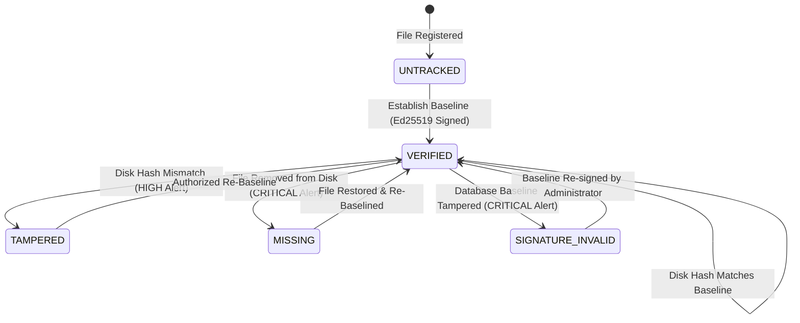

# HashWatch: Operator User Manual & Administration Runbook

**Project Title:** HashWatch: Cryptographically Signed File Integrity Monitoring System  
**Academic Group:** Group 3, Department of Computer Science & Business Systems (CSBS), Asansol Engineering College  
**Authors:** Riya, Priyanshu Ghosh, Samarjeet Kumar  
**Target Audience:** System Administrators, SecOps Engineers, Compliance Auditors  
**Release Version:** 1.0.0-RELEASE (Production Candidate)  

---

## Table of Contents

1. [System Overview & Core Innovations](#1-system-overview--core-innovations)
2. [Prerequisites & System Requirements](#2-prerequisites--system-requirements)
3. [Installation & Deployment](#3-installation--deployment)
4. [Operator Web Dashboard Walkthrough (`/`)](#4-operator-web-dashboard-walkthrough-)
5. [Incident Triage & Security Alerts Center (`/alerts`)](#5-incident-triage--security-alerts-center-alerts)
6. [Cryptographic Verification State Machine](#6-cryptographic-verification-state-machine)
7. [Automated Quartz Daemon vs. Manual Scans](#7-automated-quartz-daemon-vs-manual-scans)
8. [REST API Automation Cheatsheet](#8-rest-api-automation-cheatsheet)
9. [Troubleshooting & Incident Remediation](#9-troubleshooting--incident-remediation)

---

## 1. System Overview & Core Innovations

Conventional File Integrity Monitoring (FIM) utilities (such as Tripwire, OSSEC, or Samhain) calculate file hashes and store them in plaintext database tables or local flat files. An adversary gaining local root/administrator access or database compromise can easily alter both the target file on disk and the corresponding database hash record, completely blinding security operators.

**HashWatch** eliminates this single point of failure by introducing:

- **Triple-Lock Canonical Envelopes:** Every baseline encapsulates a domain-separated payload:
  $$\text{Payload} = \texttt{"HashWatch:v1:"} \parallel \text{NormalizedPath} \parallel \texttt{":"} \parallel \text{SHA256Hex} \parallel \texttt{":"} \parallel \text{FileSizeBytes}$$
- **Asymmetric Edwards-curve Digital Signatures (Ed25519 / RFC 8032):** Baselines are digitally signed with an out-of-database Ed25519 private key. Even if an attacker directly manipulates the PostgreSQL database table, the cryptographic signature fails verification (`SIGNATURE_INVALID`).
- **Constant Memory Footprint:** Streams files in 64 KB buffers, allowing files of arbitrary size (10+ GB) to be hashed under a strict < 256 MB JVM heap limit.
- **Deduplicated Incident Triage:** Automatically gates repeated alerts during 30-second automated Quartz polling loops, preventing operator alert fatigue.

---

## 2. Prerequisites & System Requirements

### Hardware Requirements
- **CPU:** Dual-core 2.0 GHz or higher (x86_64 or ARM64).
- **RAM:** Minimum 512 MB available (JVM configured with standard max heap 256 MB).
- **Storage:** 50 MB disk space for binaries; database storage proportional to monitored watchlist size (~2 KB per file baseline).

### Software Requirements
- **Java Runtime:** Eclipse Temurin, Oracle JDK, or OpenJDK **17 LTS** or newer.
- **Operating Systems:** Windows 10/11 / Server 2019+, Ubuntu 20.04+, Debian 11+, RHEL 8+, or macOS 12+.
- **Database (Dual Profile Support):**
  - **In-Memory H2 Database:** Zero-installation local dev and standalone mode (`spring.profiles.active=h2`).
  - **Enterprise PostgreSQL 16+:** Production multi-node deployment with connection pooling backed by HikariCP (`HashWatchHikariPool`).

---

## 3. Installation & Deployment

### Quick Start via Bundled Maven Wrapper

Clone the repository and launch with the default in-memory H2 profile:

```bash
# Clone the repository
git clone https://github.com/riyaaa0710/HashWatch.git
cd HashWatch

# On Windows (PowerShell / Command Prompt):
.\mvnw.cmd spring-boot:run

# On Linux / macOS:
chmod +x ./mvnw
./mvnw spring-boot:run
```

Once started, the Spring Boot embedded Tomcat container will initialize on port **8080**:
- **Operator Dashboard:** [http://localhost:8080/](http://localhost:8080/)
- **Security Incident Center:** [http://localhost:8080/alerts](http://localhost:8080/alerts)
- **H2 Web Console:** [http://localhost:8080/h2-console](http://localhost:8080/h2-console) (JDBC URL: `jdbc:h2:mem:hashwatch_db`)

### Running with Production PostgreSQL

Ensure PostgreSQL is running (e.g. via Docker Compose or native service) and activate the `postgres` profile:

```bash
# Launch PostgreSQL container
docker run --name hashwatch-pg -e POSTGRES_DB=hashwatch -e POSTGRES_USER=postgres -e POSTGRES_PASSWORD=postgres -p 5432:5432 -d postgres:16-alpine

# Start HashWatch with PostgreSQL profile
.\mvnw.cmd spring-boot:run -Dspring-boot.run.profiles=postgres
```

---

## 4. Operator Web Dashboard Walkthrough (`/`)

The main dashboard is organized into four intuitive operational regions:

```
+-------------------------------------------------------------------------------+
|  🛡️ HashWatch [Cryptographically Signed FIM]        Dashboard  Alerts (0) ⚡  |
+-------------------------------------------------------------------------------+
|  🟢 SYSTEM INTEGRITY SECURE                               Quartz Interval: 30s |
|     All monitored files match their signed Ed25519 envelopes.                 |
+-------------------------------------------------------------------------------+
|  [ Watched Files: 12 ] [ Active Baselines: 12 ] [ Tampered: 0 ] [ Alerts: 0 ] |
+-------------------------------------------------------------------------------+
|  Register File to Watchlist:                                                  |
|  [ /etc/nginx/nginx.conf                                  ] [+ Register File] |
+-------------------------------------------------------------------------------+
|  Monitored Files Inventory:                               [🔄 Rebaseline All] |
|  ID  Path                  Status    Active  Size    Modified       Actions   |
|  1   /etc/shadow           VERIFIED  ACTIVE  1.2 KB  14:30:12       [Rebase]  |
|  2   /etc/ssh/sshd_config  VERIFIED  ACTIVE  3.4 KB  14:32:00       [Unwatch] |
+-------------------------------------------------------------------------------+
```

### 1. Real-Time System Health Banner
- **`SYSTEM INTEGRITY SECURE` (Green Glow):** Indicates zero unresolved security alerts and zero files in `TAMPERED`, `MISSING`, or `SIGNATURE_INVALID` status.
- **`INTEGRITY BREACH / ANOMALY DETECTED` (Pulsating Red Animation):** Warns the operator instantly when a cryptographic mismatch, file deletion, or baseline database tampering is identified.

### 2. Live Telemetry Metric Cards
- **Active Watched Files:** Total filesystem targets currently under active surveillance.
- **Active Baselines:** Total current cryptographic baseline records locked with SHA-256 and Ed25519 signatures.
- **Tampered Files:** Immediate indicator of compromised files requiring urgent inspection.
- **Unresolved Alerts:** Count of pending security incidents requiring operator acknowledgment.

### 3. Registering New Files to the Watchlist
1. Enter an absolute file path into the **Register File to Watchlist** input field (e.g., `/etc/hosts` or `C:\Windows\System32\drivers\etc\hosts`).
2. Click **+ Register & Establish Baseline**.
3. The system performs immediate existence checks, verifies read permissions, streams the SHA-256 digest, generates the Ed25519 digital signature, and records the baseline in the database with status `VERIFIED`.

### 4. Watched Files Inventory Table
- **Status Pills:** Color-coded badges indicating current file integrity (`VERIFIED`, `TAMPERED`, `MISSING`, `SIGNATURE_INVALID`, `UNTRACKED`).
- **Rebaseline Button:** Generates a new cryptographic baseline when an authorized software upgrade or configuration change is applied to a file.
- **Unwatch Button:** Soft-deactivates polling on the file without destroying historical forensic audit records.

---

## 5. Incident Triage & Security Alerts Center (`/alerts`)

The dedicated **Security Alerts Center** provides a forensic audit trail of all anomalous events:

### Features & Capabilities
1. **Cryptographic Digest Comparison:** Displays a side-by-side comparison of the **Expected Hash** (from the authenticated baseline) versus the **Actual Hash** (streamed from disk during the verification pass).
2. **Multi-State Client Filtering:**
   - **All Events:** Displays full historical security audit trail.
   - **Unresolved Only:** Focuses solely on pending active threats.
   - **Critical Only:** Filters specifically for `CRITICAL` severity events (signature corruption or missing system files).
3. **1-Click Triage & Resolution:** Click the **✓ Resolve** button once an incident has been investigated and remediated. The alert transitions to `Resolved`, turning off the red cockpit warning.

---

## 6. Cryptographic Verification State Machine

Every watched file transitions through a deterministic 5-state integrity lifecycle:



| State | Severity | Cause | Remediation Action |
| :--- | :--- | :--- | :--- |
| **`VERIFIED`** | Normal | Disk bytes and Ed25519 envelope are intact. | None; system is fully secure. |
| **`TAMPERED`** | `HIGH` | Disk file altered without SecOps re-baselining. | Investigate disk file diff. If authorized, click **Rebaseline**. If malicious, restore from backup. |
| **`MISSING`** | `CRITICAL` | Monitored file was deleted or unmounted. | Restore file from backup, or click **Unwatch** if permanently decommissioned. |
| **`SIGNATURE_INVALID`** | `CRITICAL` | Database record altered or rogue key injected. | Database security breach! Investigate database audit logs and execute administrative re-baselining. |
| **`UNTRACKED`** | Warning | File registered but baseline not yet computed. | Click **Rebaseline** to generate initial cryptographic envelope. |

---

## 7. Automated Quartz Daemon vs. Manual Scans

### Automated 30-Second Polling Daemon
HashWatch bundles an automated background scheduler configured via Quartz:
- **Interval:** Every 30 seconds (`0/30 * * * * ?`).
- **Concurrency Protection:** Annotated with `@DisallowConcurrentExecution` to prevent overlapping runs on slow or heavily loaded storage.
- **Fault Isolation:** Each file is evaluated inside an isolated exception boundary; an I/O error or temporary lock on one file never stops verification of subsequent files.
- **Alert Deduplication:** If a file remains in `TAMPERED` status across multiple cycles, HashWatch deduplicates alerts, logging only once until state transitions.

### Manual Out-of-Band Integrity Scans
SecOps operators can trigger an instant out-of-band audit at any moment:
- Click the **⚡ Run Integrity Scan** button in the dashboard navigation bar.
- Or trigger programmatically via REST: `POST /api/alerts/scan-now`.

---

## 8. REST API Automation Cheatsheet

All API endpoints return standard JSON responses and enforce HTTP semantics:

### File Management (`/api/files`)
```bash
# 1. Register a single file and generate baseline
curl -X POST http://localhost:8080/api/files \
     -H "Content-Type: application/json" \
     -d '{"filePath": "/etc/nginx/nginx.conf"}'

# 2. Batch register multiple files with fault isolation
curl -X POST http://localhost:8080/api/files/batch \
     -H "Content-Type: application/json" \
     -d '{"filePaths": ["/etc/passwd", "/etc/shadow", "/etc/sudoers"]}'

# 3. Soft-delete / deactivate monitoring on a file
curl -X DELETE http://localhost:8080/api/files/1
```

### Baseline Management (`/api/baselines`)
```bash
# 1. Retrieve all active cryptographic baselines
curl -X GET http://localhost:8080/api/baselines

# 2. Export system Ed25519 Public Key and SHA-256 fingerprint for audit verification
curl -X GET http://localhost:8080/api/baselines/public-key

# 3. Regenerate and sign baseline for a specific file
curl -X POST http://localhost:8080/api/baselines/generate/1

# 4. Bulk regenerate and resign baselines for all active files
curl -X POST http://localhost:8080/api/baselines/generate-all
```

### Alert Triage & Auditing (`/api/alerts`)
```bash
# 1. Retrieve all unresolved security alerts
curl -X GET http://localhost:8080/api/alerts

# 2. Trigger an immediate out-of-band integrity scan
curl -X POST http://localhost:8080/api/alerts/scan-now

# 3. Resolve an investigated security alert
curl -X POST http://localhost:8080/api/alerts/10/resolve
```

---

## 9. Troubleshooting & Incident Remediation

### Common Scenarios & Resolutions

#### 1. "Cannot register file: file does not exist or is not readable"
- **Cause:** The specified path does not exist on disk, or the OS user executing HashWatch lacks read permissions.
- **Fix:** Verify file path spelling. On Linux, ensure `hashwatch` process has `r` permissions (`chmod +r <file>`).

#### 2. "File status remains TAMPERED after authorized update"
- **Cause:** File was edited on disk, but the cryptographic baseline was not updated.
- **Fix:** Navigate to the Dashboard, locate the file in the inventory table, and click **Rebaseline**.

#### 3. "Alert: SIGNATURE_INVALID detected on baseline"
- **Cause:** Either the database row was tampered with, or the Ed25519 keypair in `keys/` was replaced/rotated without re-baselining existing records.
- **Fix:** If keys were rotated, perform a bulk re-baseline via `POST /api/baselines/generate-all`. If unexpected, treat as an active database intrusion.

---

*HashWatch v1.0.0 — Designed and Engineered by Group 3 (CSBS, Asansol Engineering College)*
